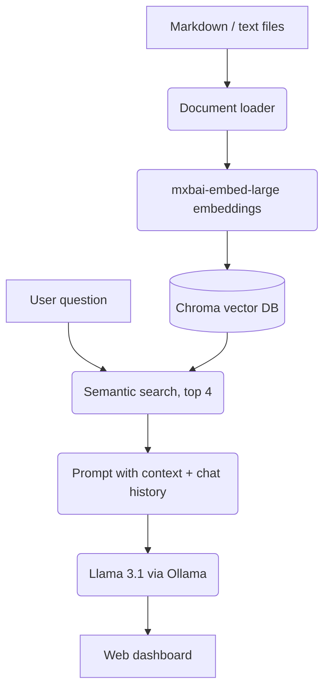

# ShieldAgent – Local RAG Cybersecurity Assistant

A retrieval-augmented generation (RAG) assistant that answers cybersecurity questions from your own documents. It runs **100% locally**, so private data never leaves your machine.

## What it does

- Upload `.md` or `.txt` documents through a drag-and-drop web dashboard
- Documents are embedded and stored in a **Chroma vector database**
- For each question, the 4 most relevant passages are retrieved by semantic search and passed to a local LLM, which answers and cites its sources
- Keeps chat history for follow-up questions
- System prompt restricts the assistant to security topics and refuses harmful requests

## Architecture



## Tech stack

| Layer | Technology |
| --- | --- |
| Language | Python 3.12 |
| RAG orchestration | LangChain |
| LLM and embeddings | Ollama (Llama 3.1, mxbai-embed-large) |
| Vector database | Chroma DB |
| Backend API | FastAPI, Uvicorn |
| Frontend | HTML, CSS, vanilla JavaScript |

## API

| Method | Endpoint | Purpose |
| --- | --- | --- |
| POST | `/api/chat` | Ask a question, get an answer with sources |
| GET | `/api/documents` | List documents in the knowledge base |
| POST | `/api/upload` | Upload a document and rebuild the index |

## Run it

```bash
# 1. Install Ollama and pull the models
ollama pull llama3.1
ollama pull mxbai-embed-large

# 2. Install dependencies
python -m venv .venv && source .venv/bin/activate
pip install -r requirements.txt

# 3. Start the server, then open http://127.0.0.1:8000
python app.py
```

## Challenges solved

- **Duplicate documents in the vector store:** Chroma appended the same documents on every restart. The index is now rebuilt cleanly from the knowledge base so it always matches the files exactly.
- **Modular design:** the RAG logic is separated from the interfaces, so the CLI and the web API share one pipeline.

A full write-up of the design, implementation and governance considerations is in [`docs/development-report.md`](docs/development-report.md).
