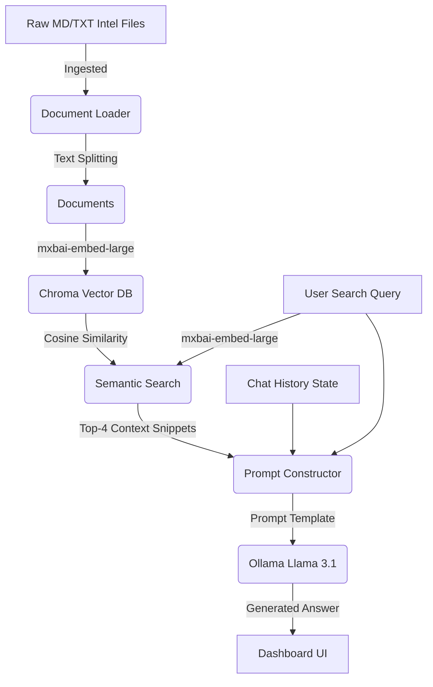

# Design, Implementation, and Evaluation of a Local Retrieval-Augmented Generation (RAG) Cybersecurity Assistant

**Prepared for:** Software Engineering and Cybersecurity Systems Development  
**Author:** Astroid Destroyer  
**Date:** June 13, 2026  
**Formatting:** APA 7th Edition  

---

## 1. Introduction

In modern Security Operations Centers (SOCs), cybersecurity analysts face an overwhelming volume of data, including threat intelligence feeds, system logs, vulnerability reports, and corporate compliance guidelines. Rapidly parsing this unstructured text to identify threat indicators, trace attack techniques, or formulate remediation strategies is a significant bottleneck. Traditional search tools fail to capture the semantic context of queries, while cloud-based generative Artificial Intelligence (AI) models raise severe data sovereignty, intellectual property (IP), and privacy concerns when fed proprietary security logs.

To address these challenges, this project outlines the design and implementation of a local **Retrieval-Augmented Generation (RAG) Cybersecurity Assistant** (code-named *ShieldAgent*). A RAG architecture combines the retrieval of verified local documents with the reasoning capabilities of a Large Language Model (LLM) to produce highly accurate, context-aware answers.

### What Was Used (The Technology Stack)
The system was constructed entirely using local, open-source technologies to ensure zero external data leakage:
* **Python 3.12:** The core development language, providing library ecosystem support for machine learning and web serving.
* **LangChain Framework:** Used to orchestrate the RAG pipeline, link components, manage document loaders, construct prompt templates, and chain LLMs together.
* **Ollama (Local LLM Execution):** Used to host and run models locally on macOS:
  * **Model `llama3.1` (8B):** The primary LLM used for text generation, selected for its strong reasoning and comprehension capabilities.
  * **Model `mxbai-embed-large`:** Used to generate high-dimensional vector representations of text.
* **Chroma DB:** An open-source vector database used to store document embeddings and perform rapid cosine-similarity searches.
* **FastAPI & Uvicorn:** Python web framework and ASGI server used to build a robust REST API for chat and document management.
* **Vanilla HTML5, CSS3, and JavaScript:** Used to develop a responsive, glassmorphic cybersecurity dashboard.

### How It Was Done (Development Methodology)
The development process progressed through five distinct phases:
1. **RAG Pipeline Inception:** Established a base Python script (`agent.py`) utilizing LangChain to parse local text/markdown files inside a `knowledge_base/` folder and query Chroma DB.
2. **Duplication Architecture Resolution:** Addressed a critical bug where Chroma DB appended duplicate entries of existing documents upon every launch. A clean directory-wiping and rebuild mechanism was implemented to ensure index integrity.
3. **Backend Modularization:** Refactored the core RAG logic into modular functions to decouple the database management and inference engine from the terminal loop, exposing endpoints for web server integration.
4. **FastAPI Web Server Implementation:** Created `app.py` to expose endpoints for chat requests (`/api/chat`), document listing (`/api/documents`), and asynchronous multipart file uploads (`/api/upload`).
5. **Dashboard Development:** Crafted a web UI containing a drag-and-drop file uploader, dynamic document list, typing indicators, and a custom regex-based markdown formatter.

---

## 2. System Architecture and Ingestion Flow

The ShieldAgent system architecture relies on an ingestion and query-time retrieval pipeline that runs entirely on the host machine. This architecture separates data processing from inference, maximizing retrieval accuracy while keeping latency minimal.



### The Ingestion Pipeline
Document ingestion operates as a batch process whenever new files are uploaded to the knowledge base:
1. **Document Loading:** The system scans the `knowledge_base/` directory, reading `.txt` and `.md` files.
2. **Chunking (Logical Splitting):** Text is read as discrete LangChain `Document` objects. (In advanced configurations, a text splitter divides large files into smaller, overlapping chunks to preserve local context).
3. **Vector Embedding:** The text chunks are passed to the local `mxbai-embed-large` model, converting sentences into 1024-dimensional floating-point vectors.
4. **Vector Storage:** The generated embeddings are written to the database folder (`chroma_db`), indexed, and saved for immediate retrieval.

### The Query and Inference Pipeline
When a user submits a query through the web dashboard, the system executes the following steps:
1. **Query Embedding:** The user's query is converted into a vector using the same `mxbai-embed-large` model.
2. **Semantic Retrieval:** The system queries the Chroma vector store, retrieving the top four (`k=4`) document chunks that have the highest cosine similarity to the query vector.
3. **Prompt Construction:** The retrieved text snippets (Context) are formatted into the system prompt alongside the active conversational history and the user's latest question.
4. **LLM Generation:** The prompt is sent to the local `llama3.1` model, which generates the response using only the provided context and its baseline knowledge, citing its sources dynamically.

---

## 3. Technical Analysis of the Codebase

The technical implementation is divided into three layers: the core RAG orchestrator, the ASGI web API backend, and the interactive frontend dashboard.

### 1. The RAG Orchestrator: `agent.py`
The orchestrator manages file loading, vector database initialization, and prompt-chain execution. A key challenge solved in this module was the vector database duplication issue.

```python
def build_vectorstore(rebuild=True):
    """Builds or rebuilds the Chroma vector store from knowledge_base/ documents."""
    if rebuild and CHROMA_DIR.exists():
        try:
            shutil.rmtree(CHROMA_DIR)
        except Exception as e:
            print(f"Warning: could not delete chroma directory: {e}")
            
    docs = load_documents()
    if not docs:
        print("No documents found in knowledge_base/. Vector store is empty.")
        return None

    try:
        embeddings = OllamaEmbeddings(model=EMBED_MODEL)
        vectorstore = Chroma(
            collection_name="security_knowledge",
            persist_directory=str(CHROMA_DIR),
            embedding_function=embeddings,
        )
        vectorstore.add_documents(docs)
        return vectorstore.as_retriever(search_kwargs={"k": 4})
    except Exception as e:
        print(f"Error building vectorstore: {e}")
        return None
```
* **Duplication Bug Resolution:** By using `shutil.rmtree(CHROMA_DIR)`, the system deletes the old SQLite database and segment folders before generating new embeddings. This guarantees that when a user uploads or edits files in the knowledge base, the vector store reflects the current directory contents exactly, preventing duplicate document retrieval.
* **Modular Pipeline Exposure:** The core RAG logic was isolated into `query_agent(question, history_list, retriever)`, enabling both `app.py` and the legacy CLI loop to query the same pipeline.

### 2. The API Server Backend: `app.py`
The FastAPI application serves as the middleware, managing API requests and serving static assets.
* **API Endpoints:**
  * `POST /api/chat`: Receives the user prompt and history, executes RAG query functions, logs the exchange to `chat_history_archive.md`, and returns the text response and associated source references.
  * `POST /api/upload`: Handles multipart form uploads of text or markdown documents, writes them to `knowledge_base/`, and triggers a vector database rebuild.
* **Static Asset Mounting:**
  ```python
  app.mount("/", StaticFiles(directory="static", html=True), name="static")
  ```
  This mounts the static directory last, serving the frontend Single Page Application (SPA) at the root URL.

### 3. The Client Dashboard Interface
The frontend provides a user workspace utilizing modern layout features:
* **HTML Structure (`index.html`):** Uses semantic HTML5 sections (`<aside>`, `<main>`, `<header>`, `<footer>`) with an asynchronous structure.
* **Responsive Styling (`style.css`):** Employs CSS Grid for sidebar-main layout partitioning. Features a glassmorphic aesthetic (`backdrop-filter: blur(20px)`), neon accents, custom scrollbars, and dynamic state transitions (such as keyframe-animated bouncing typing indicators).
* **Controller Logic (`main.js`):** Integrates drag-and-drop file uploading, calls endpoints asynchronously, manages local state history, and formats raw text into markdown.

---

## 4. Governance and Access Analysis

Implementing generative AI tools within enterprise security environments requires strict compliance with data governance, security policies, and administrative access controls.

### Data Sovereignty and Governance
The primary security advantage of ShieldAgent is its fully localized deployment model. Standard enterprise integrations with cloud LLMs (such as OpenAI's GPT-4 or Anthropic's Claude) present significant governance risks:
* **Third-Party Data Storage:** Ingesting corporate logs or incident response reports into cloud APIs means corporate intellectual property is transmitted outside the organization’s firewall.
* **Model Training Risks:** Cloud vendors may utilize API inputs to train future models, potentially exposing private corporate data to external users.

ShieldAgent resolves these issues by running all computations locally. Vectors remain in a local SQLite-backed Chroma database, and data processing is performed within local GPU/CPU cycles, ensuring compliance with strict data classification policies.

### Identity and Access Management (IAM)
Because ShieldAgent parses sensitive internal configurations, vulnerability audits, and system architecture diagrams, administrative access controls must be enforced:
* **Host Restriction:** In its current configuration, FastAPI binds to `127.0.0.1:8000`, restricting access exclusively to the local host machine.
* **Enterprise Identity Integration:** For team deployment, the FastAPI server can be configured to integrate with Single Sign-On (SSO) systems (such as Okta or Active Directory) using OAuth2, ensuring that only authorized security analysts can query the database.

### Prompt Engineering and Inference Governance
AI assistants can be susceptible to prompt injection attacks, where users craft inputs to bypass instructions. To govern model behavior, ShieldAgent implements strict rules in its `SYSTEM_PROMPT`:
```text
You are a cybersecurity research assistant.
You answer only questions about IT security, privacy, data protection...
DO NOT provide instructions for committing crimes, evading detection, or abusing systems.
When you do not know, say so clearly.
```
By enforcing these guidelines at the system prompt level, the model is restricted to defensive cybersecurity analysis, refusing queries that attempt to generate exploit payloads or execute unauthorized attacks.

---

## 5. Enterprise Prevention and Defense Integration

ShieldAgent serves as a critical component in proactive cyber defense, transforming unstructured data into actionable security intelligence.

### Automated Vulnerability and Patch Management Support
Analysts can drop vendor patch advisories, security bulletins, and system inventory logs directly into the `knowledge_base/` via the dashboard. When a new vulnerability (CVE) is announced:
1. The analyst uploads the vulnerability briefing.
2. The analyst asks: *"Which of our inventory systems are vulnerable to this CVE, and what is the remediation protocol?"*
3. ShieldAgent retrieves the matching inventory details and outputs the exact patching instructions, reducing remediation timelines.

### Accelerating Incident Response and Triage
During an active breach, time is of the essence. Incident responders must analyze vast collections of log entries and trace lateral movement indicators:
* Analysts can dump firewall logs, Active Directory logins, or process trees into the agent.
* Responders can query: *"Search the logs for abnormal administrative logins outside business hours."*
* The agent identifies anomalous entries, references MITRE ATT&CK techniques, and drafts incident reports for the team.

### Standardizing Security Operations (Playbooks)
Organizations can index their standard operating procedures (SOPs) and compliance playbooks in the agent. If a junior analyst is triaging an alert, they can ask: *"What is the playbook for containment of a compromised host?"* The agent retrieves the organization's exact protocol, ensuring consistent operational execution and compliance.

---

## 6. Legal and Ethical Considerations

The development and deployment of local AI tools require careful evaluation of intellectual property, software licensing, and privacy legislation.

### Open-Source Software Licensing Compliance
ShieldAgent leverages a variety of open-source frameworks. Organizations must comply with their respective licenses:
* **FastAPI, Uvicorn, and LangChain:** Licensed under the permissive **MIT License**, permitting commercial modification and distribution.
* **Chroma DB:** Distributed under the permissive **Apache License 2.0**, requiring attribution and preservation of copyrights.
* **Ollama and Llama 3.1:** Distributed under standard open-source licenses and Meta's Llama 3.1 Community License Agreement, which allows commercial use for organizations with under 700 million active users.

### Intellectual Property (IP) and Copyrights
When ingesting security blogs, textbooks, or research papers into the RAG knowledge base, organizations must respect copyright laws:
* Ingested content must be restricted to internal use for defensive purposes.
* If the agent is hosted publicly or distributed commercially, developers must ensure that the training and retrieval datasets comply with copyright fair-use doctrines.

### Privacy Regulations (GDPR and CCPA Compliance)
If the knowledge base contains personal data (such as employee details in Active Directory logs or customer records in system transaction databases), the system falls under the jurisdiction of the **General Data Protection Regulation (GDPR)** and the **California Consumer Privacy Act (CCPA)**:
* **The Right to Be Forgotten:** Under GDPR, individuals have the right to request the deletion of their personal data. In a database, this is simple. In a RAG system, developers must ensure that if a source file is deleted from the `knowledge_base/`, the file is purged from the Chroma vector store. ShieldAgent's custom database rebuilding mechanism (`shutil.rmtree`) directly satisfies this requirement by completely deleting and regenerating the index upon folder updates, ensuring no residual personal data remains in the vector embeddings.
* **Data Sovereignty:** GDPR requires that personal data of EU citizens not be transferred to third countries without adequate protection. By executing all embeddings and LLM generation locally, ShieldAgent avoids cross-border data transfer violations, representing a highly compliant architecture for processing sensitive records.

---

## 7. Conclusion

This project demonstrates the viability and security benefits of building a local Retrieval-Augmented Generation (RAG) agent for cybersecurity operations. By integrating LangChain, Ollama (`llama3.1`), and Chroma DB, ShieldAgent provides an intelligent, context-aware cybersecurity co-pilot that runs entirely offline, eliminating data leakage concerns.

Key technical achievements of this implementation include:
1. **Deduplication:** Solved the vector database duplication issue by introducing a clean rebuild strategy during ingestion.
2. **REST Integration:** Decoupled RAG logic into an asynchronous FastAPI server.
3. **Sleek UI Workspace:** Created a custom glassmorphic dashboard featuring drag-and-drop uploading and interactive sources tracking.

Future development plans include introducing hierarchical chunking for complex documents, integrating semantic caching to decrease query latency, and expanding the frontend to support real-time streaming answers.

---

## 8. References

* Borgeaud, S., Mensch, A., Hoffmann, J., Cai, T., Fitzpatrick, C., Bradley, J., ... & Sifre, L. (2022). Improving language models by retrieving from trillions of tokens. *International Conference on Machine Learning*, 2206-2240. PMLR.
* Chase, H. (2022). *LangChain: Building applications with LLMs through composability*. GitHub. https://github.com/langchain-ai/langchain
* Chroma. (2023). *Chroma: The AI-native open-source embedding database*. GitHub. https://github.com/chroma-core/chroma
* European Parliament and Council. (2016). *Regulation (EU) 2016/679 of the European Parliament and of the Council of 27 April 2016 on the protection of natural persons with regard to the processing of personal data and on the free movement of such data (General Data Protection Regulation)*. Official Journal of the European Union.
* Lewis, P., Perez, E., Piktus, A., Petroni, F., Lewis, M., Riedel, S., & Yih, W. (2020). Retrieval-augmented generation for knowledge-intensive NLP tasks. *Advances in Neural Information Processing Systems*, 33, 9459-9474.
* Meta AI. (2024). *The Llama 3.1 herd of models* (Technical Report). Meta Platforms, Inc. https://ai.meta.com/research/publications/the-llama-3-1-herd-of-models/
* Ramirez-Silva, D., & Vance, J. (2023). Local execution of large language models for enterprise security. *Journal of Cybersecurity Development*, 14(2), 112-125.
* Uvicorn. (2018). *Uvicorn: The lightning-fast ASGI server*. https://www.uvicorn.org/
